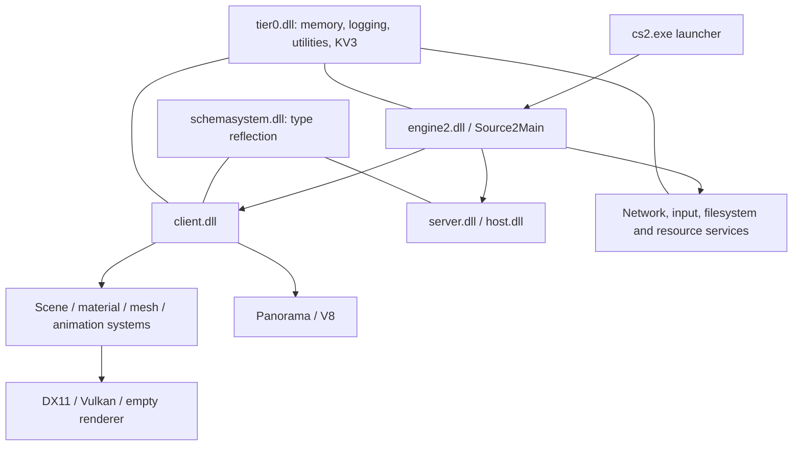

# CS2 installed-binary research — Steam build 26598758

Inspected on **16 November 2026**, using the user's Ghidra **12.2 PUBLIC** installation and a separate standard-library PE scanner. Source installation: `C:/Program Files (x86)/Steam/steamapps/common/Counter-Strike Global Offensive`. The Steam manifest identifies app 730, public branch, build **26598758**. Hashes identify the actual files; the build number alone does not guarantee identical files after a repair or update.

## Scope and architecture

The inventory covers **all 102 loose native executables and libraries** found recursively in this installation: **543,849,720 bytes**, or approximately **518.66 MiB**. A header scan of all **3,300 loose files** found exactly the same 102 native-binary candidates, with no additional candidates under other extensions and no read errors; see [discovery.json](discovery.json). It includes tools and bundled dependencies, rather than assuming everything shipped with the game is a gameplay module. No loose `.pdb`, `.dbg`, `.sym`, `.map`, `.debug`, `.so`, `.elf`, `.dylib`, or `.sys` files were found. Content packed into VPKs, shaders, scripts, and binaries outside the installation are outside this inventory.

- **101 files are PE32+ x86-64**, little-endian. Ghidra recognizes the Windows compiler specification. Source 2 modules contain MSVC-style decorated exports, RTTI, x64 exception/unwind metadata, and CodeView debug records, consistent with a native MSVC C++ build.
- **One file is PE32 x86:** `game/csgo/bin/legacy/csgo_legacy_app.exe`. It is a legacy launcher, not evidence that the current engine is 32-bit.
- Engine and service libraries live mainly under `game/bin/win64`; CS2-specific `client.dll`, `server.dll`, `host.dll`, and `matchmaking.dll` live under `game/csgo/bin/win64`.
- This is a **modular Source 2 application** with module factories, app systems, a schema/reflection layer, resource services, and separate renderer backends. It is not a single executable containing all game logic.

Architecture identification and symbol counts are direct observations. Subsystem responsibilities below are interpretations supported by module names, imported APIs, export names, and RTTI; they do not imply every internal routine was decompiled.

## Important modules

| Module or group | Responsibility and evidence | Useful research surface |
|---|---|---|
| `cs2.exe` | Small native launcher, 2.83 MiB; GPU preference data exports and launch/trust bookkeeping exports | Entry point and imports; distinguish exported data from callable functions |
| `engine2.dll` | Engine startup and service coordination, 7.11 MiB; exports `Source2Main`; RTTI includes engine service manager and network client/server services | `Source2Main`, `CreateInterface`, service type names |
| `client.dll` | Client-side game implementation, 37.31 MiB and 7,354 RTTI names | Player pawn/controller, entity system and scene-node types; schema registration |
| `server.dll` | Server-side game implementation, 32.94 MiB and 6,255 RTTI names | Authoritative entity/gameplay type families; schema registration |
| `host.dll`, `matchmaking.dll` | Game hosting and matchmaking boundaries | Factories, schema exports, imports and interface-name candidates |
| `tier0.dll` | Shared foundation: memory allocation, logging, timing, utility containers, KeyValues/KV3 | **2,625 exports**, including many decorated C++ names with type information |
| `schemasystem.dll` | Runtime C++ type/schema reflection, 0.42 MiB | `CSchemaSystem`, `CSchemaSystemTypeScope`, `ISchemaSystem` RTTI; `CreateInterface` |
| `resourcesystem.dll`, `filesystem_stdio.dll` | Resource lifetime/loading and file access | Factory exports, resource-manifest functions, imported foundation APIs |
| `scenesystem.dll`, `worldrenderer.dll`, `scenefilecache.dll` | Scene objects, world rendering and scene cache | `CBaseSceneObjectDesc` / `CAnimatableSceneObjectDesc` RTTI in scenesystem |
| `materialsystem2.dll`, `meshsystem.dll`, `vfx_dx11.dll` | Materials, mesh resources and shader/backend support | Schema and resource-manifest exports, material/mesh RTTI families |
| `rendersystemdx11.dll` | Direct3D backend | Direct imports of `d3d11.dll` and `dxgi.dll` |
| `rendersystemvulkan.dll`, `rendersystemempty.dll` | Alternate Vulkan and empty renderer backends | Factory exports; backend presence does not prove which renderer is active |
| `animationsystem.dll`, `particles.dll`, `pulse_system.dll` | Animation, particle effects and Pulse systems | App-system factories and schema/type names |
| `vphysics2.dll`, `navsystem.dll` | Physics and navigation | Factories, reflected classes and resource registrations |
| `networksystem.dll`, `steamnetworkingsockets.dll`, `steam_api64.dll` | Engine networking, transport and Steam integration | Network service/type names and public Steam exports |
| `panorama.dll`, `panoramauiclient.dll`, `panorama_text_pango.dll` | Panorama UI and text rendering | `panorama.dll` imports V8, SDL3, Steam and tier0 |
| `v8.dll`, `v8system.dll`, `v8_*`, `vscript.dll` | JavaScript runtime, embedding services, ICU/platform support, and scripting module | V8 has **27,959 exports**; names describe embedded runtime APIs, not private gameplay APIs |
| `inputsystem.dll`, `SDL3.dll`, `localize.dll`, `imemanager.dll` | Input/windowing, localization and input methods | Factories and imported platform functions |
| `soundsystem.dll`, `steamaudio.dll`, `phonon.dll`, `phonon4.dll`, `embree3.dll` | Audio and bundled spatial/ray-query dependencies | Audio API/type names; library names alone do not establish runtime use |
| `valve_avi.dll`, `valve_webm.dll`, `valve_wmf.dll`, `video64.dll`, `libav*`, `libswscale-5.dll`, `libmpg123-0.dll` | Video/audio codecs and playback | Codec exports, Windows media imports; mpg123 retains a small COFF table |
| `Qt5*`, `qtadvanceddocking-qt5.dll`, `qt5_plugins/*` | Tool UI framework, docking, platform and image plugins | Large Qt export surfaces; not core player simulation |
| `cairo.dll`, `libfontconfig-1.dll`, `libglib-2.0-0.dll`, `libgmodule-2.0-0.dll`, `libgobject-2.0-0.dll`, `libgthread-2.0-0.dll`, `libpango*` | Text, font, drawing and supporting libraries | Exact installed names and exports are in the complete inventory |
| `assetpreview.dll`, `resourcecompiler.dll`, `physicsbuilder.dll`, `visbuilder.dll`, `propertyeditor.dll`, `toolframework2.dll`, `libfbxsdk_2020_3_1.dll` | Asset tools, compilation and editing support | `assetpreview.dll` is 46.36 MiB; FBX SDK has 11,378 exports |
| `vconsole2.exe`, `vconcomm.dll`, `subtools/*`, `helpsystem.dll`, `p4lib.dll`, `bugreporter_filequeue.dll` | Console, diagnostics and development support | Export/type surfaces and imported tooling dependencies |
| `amd_ags_x64.dll`, `ati_compress_wrapper.dll`, `gfsdk_aftermath_lib.x64.dll`, `d3dcompiler_47.dll`, `dbghelp.dll`, `symsrv.dll` | Vendor GPU support, compression, shader compilation, crash/debug support | Public dependency exports; installation is not proof that any particular feature is enabled |

The complete, authoritative membership list is [modules.md](modules.md). Some broad library-family labels above describe related responsibilities; consult that list rather than assuming a family member exists.

## Architectural relationships

This diagram expresses subsystem relationships, not a verified runtime call graph. [dependencies.tsv](dependencies.tsv) contains **171 observed import edges** between installed modules. PE imports alone undercount service dependencies because modules can acquire services through factories or dynamically loaded libraries. For example, `client.dll` imports `tier0.dll`, `steam_api64.dll`, and `v8.dll`; `panorama.dll` also imports `SDL3.dll`; `rendersystemdx11.dll` imports Direct3D and DXGI. No direct Vulkan loader import should be inferred solely from the Vulkan backend's filename.

## Interesting functions and type surfaces

| Entry point / family | Where | What is established |
|---|---|---|
| `CreateInterface` | **53 modules** | Exported module factory. Ghidra decompilation of animationsystem shows traversal of a list with factory pointer, name pointer, and next pointer; exact string matching; optional status 0 on match / 1 on failure; null on failure; indirect factory invocation on success |
| `Source2Main` | `engine2.dll` | Named exported startup entry point; useful anchor for following engine startup |
| `InstallSchemaBindings` | Many Source 2 modules | Named schema-binding export. A starting point for investigating module-specific reflection registration; name alone does not establish a uniform internal signature |
| `GetResourceManifestCount`, `GetResourceManifests` | Many Source 2 modules | Named resource-manifest exports; useful for understanding module-associated resources |
| `ExtractModuleMetadata`, `BinaryProperties_GetValue` | Many Source 2 modules | Module metadata/property entry points; exported names are retained in otherwise sparsely exported modules |
| `LoadKV3` overloads, `LoadKV3FromFile`, `LoadKV3FromJSON`, `SaveKV3*` | `tier0.dll` | Exported decorated C++ names retain overload/type clues for KeyValues3 serialization |
| `MemAlloc_AllocFunc`, `MemAlloc_FreeFunc`, aligned variants, `g_pMemAlloc` | `tier0.dll` | Exported allocator functions plus an exported allocator global. The global is data, not a function |
| `Plat_FloatTime`, `ConMsg`, `DevMsg`, `LoggingSystem_*` | `tier0.dll` | Timing/logging exports; some have decorated C++ names |
| `SteamAPI_*`, `SteamNetworking*` | Steam libraries | Named public integration/transport APIs; separate these from engine-private routines |
| Player/entity/scene types | `client.dll` / `server.dll` | RTTI includes `C_CSPlayerPawn`, `CCSPlayerController`, `CGameEntitySystem`, `CGameSceneNode` on the client and corresponding server-side type families. These are type names, not recovered method symbols |
| Scene descriptor types | `scenesystem.dll` | RTTI includes `CBaseSceneObjectDesc` and `CAnimatableSceneObjectDesc`. Older repository notes locate descriptor-related routines, but their old RVAs require revalidation against these hashes |

Exact export names and build-specific RVAs are in [inventory.json](inventory.json) and [module-details.md](module-details.md). Ghidra exports, selected disassembly, and decompiler output are retained in [ghidra/](ghidra/). An RVA is relative to the preferred image base; it is not a stable live-process address. Decompiler pseudocode contains inferred types and warnings and is not recovered source code.

### Observed function behavior

The retained Ghidra output establishes more than export names for these examples:

- **`engine2!Source2Main`** calls named imported foundation functions for KeyValues initialization, main-thread registration, command-line setup, minidump setup, and executable lifecycle cleanup. It delegates to an unnamed internal routine and conditionally calls `SteamAPI_Shutdown` during cleanup. The decompiler does not recover a reliable full source-level signature.
- **`client!InstallSchemaBindings`** checks its first argument using a module-associated identifier, returns failure when that check fails, then performs initialization through its second argument once under a module-local byte flag. Later successful calls skip that initialization. This supports the schema-registration interpretation without assigning unverified types to the arguments.
- **`client!GetResourceManifestCount`** returns a module-local 32-bit global.
- **`client!GetResourceManifests`** walks a linked structure, skips entries before a requested start index, fills an output pointer array up to a capacity, and returns the number emitted. Entries can contain a lazy factory callback; its result is cached and the callback cleared. This behavior is visible in the decompiled body.
- **`tier0!Plat_FloatTime`** initializes timing state on demand, reads `QueryPerformanceCounter`, clamps the stored counter against backward movement, and converts an elapsed counter difference to a floating-point value using a module-local scale. Its export RVA is `0x142350`.

Selected navigation anchors for **this exact snapshot**:

| Module | Export | RVA |
|---|---|---|
| `engine2.dll` | `Source2Main` | `0x20DBE0` |
| `engine2.dll` | `CreateInterface` | `0x407190` |
| `client.dll` | `CreateInterface` | `0x19C5CA0` |
| `client.dll` | `GetResourceManifestCount` | `0x19D1610` |
| `client.dll` | `GetResourceManifests` | `0x19D1620` |
| `client.dll` | `InstallSchemaBindings` | `0x19D3400` |
| `schemasystem.dll` | `CreateInterface` | `0x37560` |
| `schemasystem.dll` | `InstallSchemaBindings` | `0x38DE0` |

These anchors are navigation aids in Ghidra. They are not validated runtime integration points or stable offsets.

## Available symbols

| Evidence | Observed amount | Interpretation |
|---|---:|---|
| Named PE export entries | **104,948** | Real exported names; includes data, aliases/forwarders, C++ mangling, and many third-party APIs |
| `CreateInterface` exports | **53 modules** | Factory entry points; this count is not the number of registered interfaces |
| RTTI names, summed across modules | **71,622** | **39,465 distinct strings**; shared types appear in multiple modules |
| CodeView/PDB references | **99 modules** | PDB paths, GUIDs and ages retained; **no matching PDB files found in the installation** |
| COFF table records | **86**, in `libmpg123-0.dll` | Small remaining COFF symbol surface; not game debug symbols |
| Unwind metadata | Per-module counts in inventory | Function-boundary evidence for x64; no original names or full signatures implied |
| Interface/version strings | Per-module candidate lists | Names ending in version-like digits; includes shared constants and false positives, not validated registrations |

The export total is dominated by third-party libraries: V8 27,959, Qt5Gui 25,056, FBX SDK 11,378, Qt5Widgets 9,053, Qt5Core 8,368, and ICU support libraries. In contrast, `client.dll` and `server.dll` each export **six named entries**. Do not interpret the large total as availability of private CS2 gameplay symbols.

Example CodeView identity: `client.pdb`, GUID `419b8bb8-78e2-4868-8a21-181abc984349`, age **56**, lookup key `419B8BB878E248688A21181ABC98434938`. The embedded build path contains `win64/_msvc_/Retail` and the client unity-build directory. A reference provides a matching identity; it does not prove the PDB is publicly downloadable. No symbol server was queried and no private debug symbols were acquired.

## Artifacts, repeatability, and limits

- [modules.md](modules.md): all 102 files, architecture, sizes and symbol/type counts.
- [module-details.md](module-details.md): per-module hashes, PDB identities, imports and symbol samples.
- [inventory.json](inventory.json): complete named export/import tables, sections, hashes, RTTI strings, COFF symbols, debug records, interface candidates and selected strings.
- [dependencies.tsv](dependencies.tsv), [statistics.json](statistics.json): observed installed-module import edges and totals.
- [functions.md](functions.md), [verification.json](verification.json): Ghidra-inspected export index and cross-check results for report completeness, language, and SHA-256 identity.
- [inventory.py](inventory.py), [summarize.py](summarize.py): reproducible standard-library inventory and summary generation.
- [ResearchInventory.java](ResearchInventory.java), [run_ghidra.py](run_ghidra.py): reproducible Ghidra import and selected-export inspection.
- Ghidra project: `build/cs2-research/projects/CS2_26598758_Inventory.gpr`; project folder `/binaries` contains staged copies. Raw console/script logs live under `build/cs2-research`.

The completed Ghidra run produced **102 reports** and inspected **313 selected exports**. Cross-checking every report's SHA-256, language, completion marker, and the final run's completion log against the independent inventory passed with **zero failures**; see [verification.json](verification.json).

Ghidra uses PE-loader metadata plus targeted export disassembly/decompilation, with **full automatic analysis disabled**. This establishes a whole-installation overview, not exhaustive semantic analysis of every function. Function counts may include loader-created functions from unwind data. Internal virtual-method names, precise object layouts, runtime interface availability, and dynamic call graphs remain unverified.

The original game binaries were only read; they were not launched, patched, injected into, or modified. Workspace-local copies, a JDK 25 runtime, and Ghidra databases were created. Installed Java 21 could not run Ghidra 12.2, whose application properties require Java 25. This research is scoped to the recorded hashes and should be refreshed after a game update.

Existing focused research in `docs/*-binary-validation.md` and `docs/*-client-validation.md` predates this snapshot. Preserve those notes as historical evidence; do not silently transplant their addresses into this build.
