# Runtime reliability redesign — 16 November 2026

This change applies the [build 26598758 binary research](research/cs2-26598758/overview.md) to startup, discovery, and resource ownership. The app remains a native x64 DLL with its existing menu and feature implementations.

## Problems corrected

| Before | After |
|---|---|
| Code signatures scanned the entire mapped image, including headers and non-code data | Module scans validate native PE architecture and section bounds and scan executable sections only |
| Discovery chose the first matching byte sequence | Startup, hook, interface, and resolver discovery require exactly one executable match; missing/duplicate results leave the target unavailable |
| The frame-stage pattern matched two unrelated functions | An extended pattern matches only RVA `0xB628B0`, corroborated by the `CSource2Client` primary vtable and a frame-stage switch |
| Resolver-side CreateMove pattern matched 38 functions | Resolver and hook share the same existing unique CreateMove pattern, RVA `0xB5AF90` |
| RIP-relative resolution dereferenced unchecked displacement bytes | Checked reads, instruction-layout validation, signed arithmetic, and overflow checks return null on invalid input |
| Resolved globals could retain earlier initialization values | Resolver initialization resets every published pointer and validates readable destinations; completed teardown resets them again |
| A function address was stored in `interfaces::client`, described as an interface object | `interfaces::frame_stage_notify` explicitly owns a code address; the placeholder module-base-plus-zero hook path is removed |
| Entity-system discovery mutated an unsynchronized static cache | Cache access is serialized; a changed/missing module invalidates the slot; teardown resets its module and retry state |
| The monitor started outside initialization's exception handling, followed by an unconditional ten-second delay and modal prompts | A session owns initialization, polls required module/overlay entry-point readiness, supports END cancellation, and starts workers after discovery |
| Teardown removed hooks before joining the feature worker | The feature worker stops first; hooks restore while the state monitor is alive; monitor and interfaces stop afterward. Failed cleanup retains dependencies and the DLL |
| Missing render dependencies produced a generic timeout | Timeout identifies missing modules and explains the current D3D11/Steam-overlay requirements; backend presence is not treated as proof of active renderer |

## Startup and shutdown ownership

```mermaid
flowchart LR
    Wait[Wait for modules and unique overlay entry points] --> Interfaces[Discover optional interfaces and callbacks]
    Interfaces --> State[Start state monitor]
    State --> Hooks[Prepare and enable hooks]
    Hooks --> Worker[Start feature worker]
    Worker --> Ready[Run until END]
    Ready --> Join[Join feature worker]
    Join --> Remove[Stop callbacks and remove hooks]
    Remove --> Monitor[Stop state monitor]
    Monitor --> Release[Release interfaces and reset resolver]
```



Startup failures stop every service whose start was attempted and may have published resources. `hooks::create()` remains responsible for its own partial hook rollback. The state monitor stays alive while hooks restore skybox state, because restoration needs its snapshot. A stop failure halts teardown before the failed service's dependencies are released. Failed cleanup can be retried; repeated successful stops do not destroy services twice.

Rendering integration still requires the Steam overlay and a D3D11-backed swap chain. The researched Vulkan backend is not implemented by this app. The real swap-chain COM query remains the runtime renderer check. Optional game signatures do not become mandatory overlay dependencies.

## Binary evidence

The original frame-stage pattern matched client RVAs `0xB628B0` and `0xDDBA00`. The latter's decompiled body operates on entity handles and does not show the former's stage dispatch. RTTI identifies one `CSource2Client` primary vtable at RVA `0x1C5AA90`; slot 36 points to `0xB628B0`. That function switches over stages including 3 through 12. Its extended signature includes the following pointer load and stage-register preservation, distinguishing it from the unrelated routine without hardcoding its RVA in runtime code.

The old resolver CreateMove pattern matched 38 executable locations. It has no independent ownership now: its constant aliases the existing hook's unique signature. Ghidra's body at `0xB5AF90` uses the split-screen index and active flag, consistent with the existing hook boundary. This does not establish the complete engine ABI or validate live behavior.

The read-only audit checks **25 patterns**, including the three Steam-overlay rendering callbacks. All have one executable match in this snapshot. Hashes and results are recorded in [runtime-signature-validation.json](research/cs2-26598758/runtime-signature-validation.json). Run:

```powershell
python tests/inspect_runtime_signatures.py "C:\Program Files (x86)\Steam\steamapps\common\Counter-Strike Global Offensive" --output build/runtime-redesign-signatures.json
```

For Ghidra investigation, [InspectFunctions.java](research/cs2-26598758/InspectFunctions.java) accepts an output filename followed by hexadecimal RVAs. The retained local comparison is `build/runtime-frame-candidates.txt`; decompiler warnings and inferred argument types are preserved. The existing Ghidra project was opened read-only for this comparison.

## Verification

`tests/pattern_scanner_smoke.cpp` exercises synthetic mapped images, duplicate signatures in data/code and across sections, wrong architecture, malformed/truncated sections and headers, inaccessible pages, signed displacements, invalid layouts, and arithmetic overflow.

`tests/runtime_startup_regressions.cpp` compiles the production startup session with fake services. It injects a failure at each start phase, checks worker-first cleanup and partial-start cleanup, verifies repeated stops, and checks that a failed worker stop preserves dependencies and permits retry. No target binary is executed by these tests.

The full suite is `powershell -NoProfile -ExecutionPolicy Bypass -File tests/run_all.ps1`. Release output is isolated at `build/runtime-redesign/manager.dll`; compilation uses the actual `manager.vcxproj`, Release x64. MSBuild requires access to its file tracker in this environment.

Validation completed: all **17 regression suites passed**, all **25 audited signatures matched uniquely**, and the **Release x64 DLL built successfully**. The startup regression was rerun after the final restoration-order correction and passed. Artifact identity is recorded in `build/runtime-redesign/validation.json`; full suite and build logs are `build/runtime-redesign-tests.log` and `build/runtime-redesign-build.log`.

These changes address code-discovery and lifecycle failure modes. They do not validate gameplay semantics, private object layouts, renderer output, or behavior in a live CS2 session. Keep generated schemas and other existing feature work separate from the confidence established by this audit.
